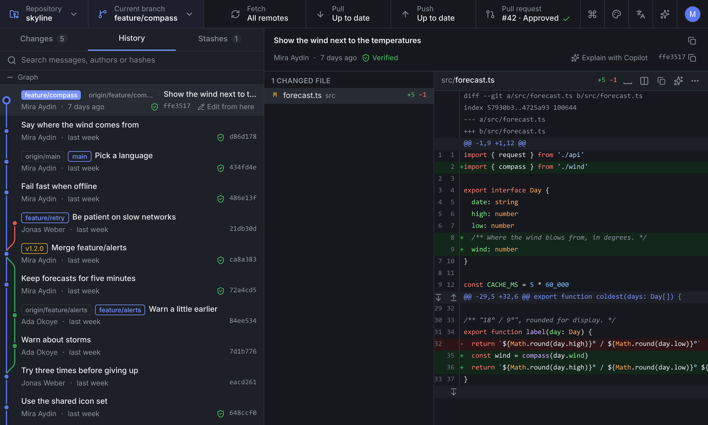
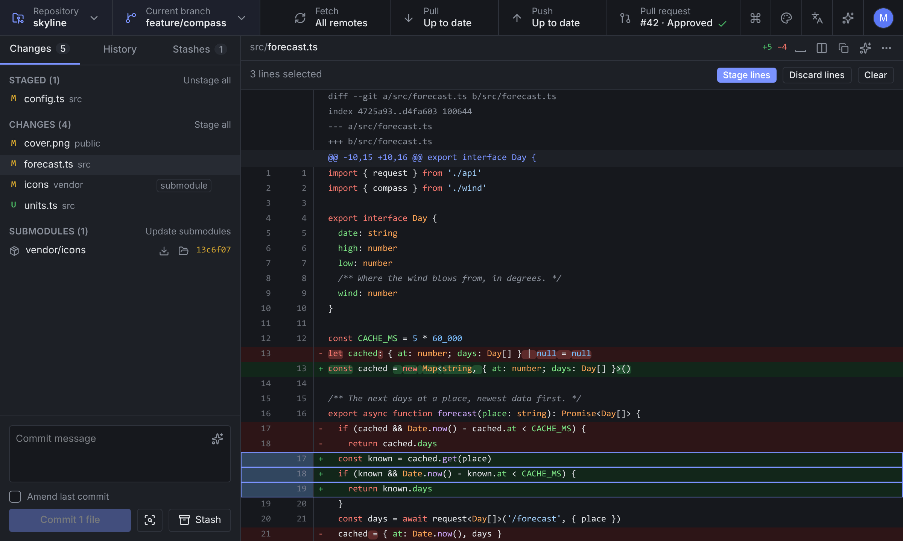
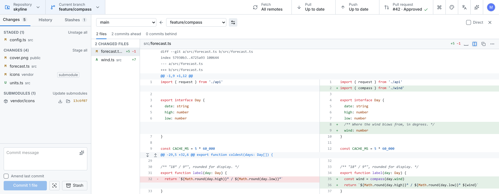
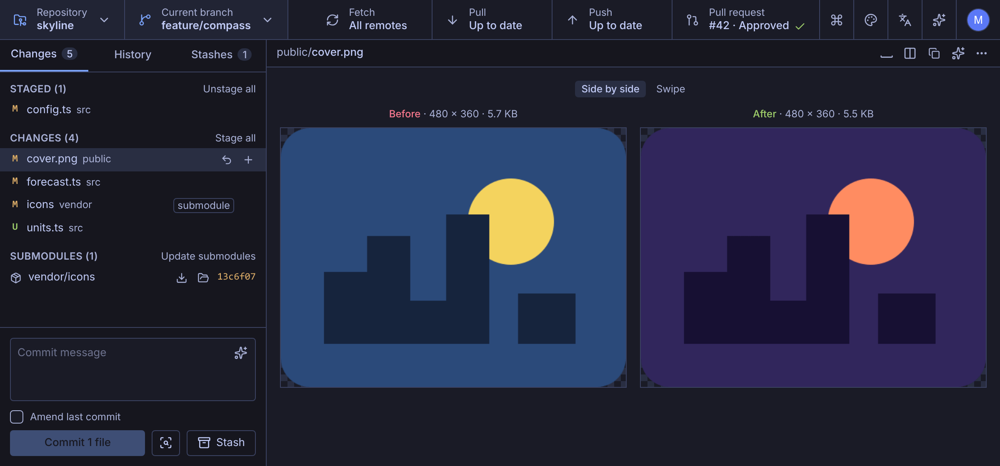
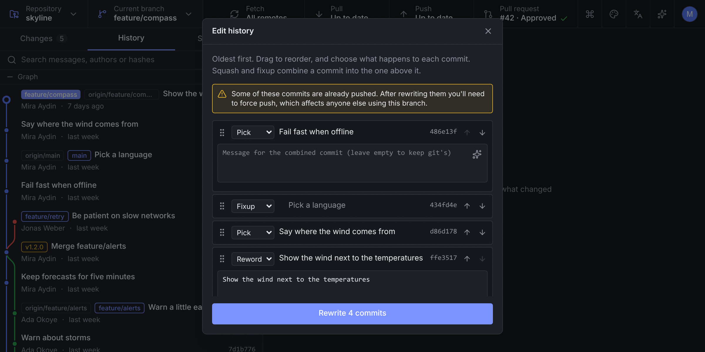
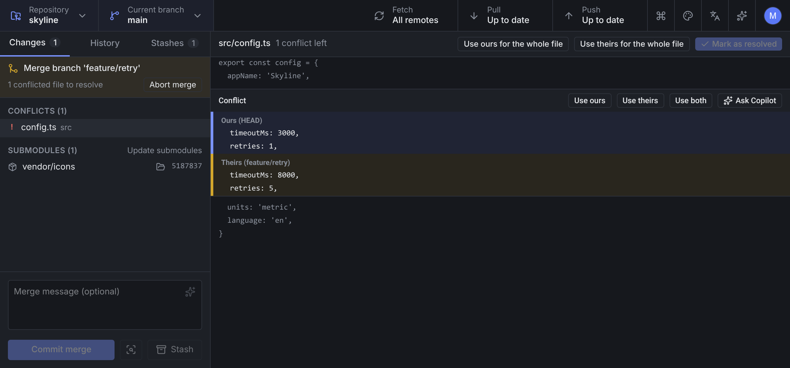
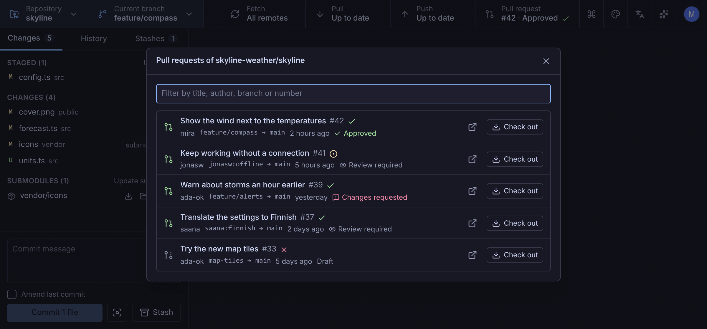

<p align="center">
  <picture>
    <source media="(prefers-color-scheme: dark)" srcset="logo/logo-dark.png">
    
  </picture>
</p>

<p align="center">
  <em>git gud at git.</em>
</p>

<p align="center">
  <a href="https://qiral.github.io/gitgud/">Website</a>
</p>

<p align="center">
  <a href="https://github.com/qiral/gitgud/actions/workflows/ci.yml"></a>
  <a href="https://github.com/qiral/gitgud/releases/latest"></a>
  <a href="LICENSE"></a>
</p>

A fast, lightweight, open-source Git GUI for Linux, Windows and macOS.

GitGud aims to be as approachable as GitHub Desktop while exposing more of Git's power: history, branches, stash, merges, conflict resolution and interactive rebase, without hiding what Git is doing.

> **Status:** early development. Expect rough edges.

[**Download the latest release**](https://github.com/qiral/gitgud/releases/latest)



[Features](#features) · [Keyboard shortcuts](#keyboard-shortcuts) · [Install](#install) · [Development](#development) · [Contributing](#contributing)

## Features

### Commit exactly what you want

Click line numbers in a diff to stage, unstage or discard single lines (Shift+click for a range), or take a whole hunk from its header. The arrows on a hunk header show more of the file around it.



- Amend the last commit, or commit with `Ctrl+Enter`
- Stash changes (optionally with untracked files), then apply, pop, preview or delete stashes
- Add an untracked file, its extension or its folder to `.gitignore` from its right-click menu
- Sign commits with a GPG or SSH key ("Commit signing" in the command palette); History shows Verified, Unverified or Bad signature
- Undo right after a commit, amend, merge, cherry-pick, revert, history edit, reset (even a hard one), branch or stash deletion or discarded changes; nothing done since then gets overwritten

### Read diffs

Unified or side by side, with changed words marked, whitespace ignored if you like, and syntax highlighting in your theme's colors for 45+ languages. Compare two branches (`Ctrl+Shift+D`) or two commits (`Ctrl`+click in History).



Images are compared as images, side by side or with a swipe slider.



### Find your way through history

- Commit graph across all branches, remote branches and tags; collapse it to one line, or hide single branch lines with the "−" on their dots
- Search by message, author or hash, and follow a single file's history across renames
- Blame a file on disk or at any commit, jump to the commit behind a line, or keep walking back through parents
- Cherry-pick, revert, reset (soft, mixed or hard), branch or tag from a commit's right-click menu
- Browse the reflog and recover deleted stashes

### Rewrite it

Drag commits into a new order, squash, fixup, reword or drop them.



### Merge and resolve conflicts

Resolve conflicts block by block (ours, theirs or both), or take one side for the whole file. Pull asks whether to merge or rebase when both sides moved on, or follows your `pull.rebase` setting.



### Pull requests

Create one for the current branch (`Ctrl+R`), as a draft if you like; branches pushed to a fork go to the parent repository. The toolbar shows its checks and review. "Pull requests" in the repository menu lists the open ones and checks any of them out, forks included.



### Branches, remotes, submodules, worktrees

- Create, filter, switch, rename and delete branches; unmerged ones ask before they go
- Add, rename, edit, fetch or remove remotes, add a fork's parent as `upstream` in one click, and set a branch's upstream
- Submodules are listed under Changes with the commit they're on: update them, or open one as its own repository. Cloning can download them too
- Add, open and remove worktrees; a branch checked out in another one says where
- Clone from a URL or from your GitHub repositories, and publish a local repository to GitHub in one step

### Accounts

- Sign in with GitHub (device flow) to push over HTTPS
- Sign in to GitLab, Gitea, Forgejo or any other HTTPS host with a personal access token
- Tokens stay in the OS keychain, and each is only sent to its own host

### GitHub Copilot, if you have it

With a Copilot plan, GitGud can write commit, stash and squash messages, pull request descriptions, branch names and release notes, review staged changes, explain commits and git errors, summarize branches, and suggest merges for conflicts. Each action can be turned off from the Copilot menu.

GitGud runs the [Copilot CLI](https://github.com/github/copilot-cli) you already have, or downloads it once into its own folder, with its own settings so your Copilot MCP servers and plugins aren't loaded. It sends only the diff or conflict you asked about, so organization content exclusions don't apply to it.

### Make it yours

40 themes with live previews (`Ctrl+,`), one for day and one for night if you follow your system. Change the accent color, the code font and its size, or use blue and orange diffs if red and green look alike to you.


- English, Türkçe, Azərbaycanca, Deutsch, Français, Italiano, Español, 日本語, 简体中文 and 한국어, switched without a restart
- A command palette (`Ctrl+K`) for every action
- Resizable panels that remember their size
- Tells you when a new version is out and updates itself after you click (AppImage, Windows and macOS)

### Keyboard shortcuts

Use `Cmd` instead of `Ctrl` on macOS.

| Shortcut | Action |
| --- | --- |
| `Ctrl+K` | Command palette |
| `Ctrl+P` / `Ctrl+Shift+P` | Push / Pull |
| `Ctrl+Shift+T` | Fetch |
| `Ctrl+R` | Create or view the branch's pull request |
| `Ctrl+B` | Switch branch |
| `Ctrl+Shift+N` | New branch |
| `Ctrl+Shift+M` | Merge a branch into the current one |
| `Ctrl+Shift+D` | Compare a branch with the current one |
| `Ctrl+Shift+S` | Stash changes |
| `Ctrl+1` / `Ctrl+2` / `Ctrl+3` | Changes / History / Stashes |
| `Ctrl+F` | Search history |
| `Ctrl+O` / `Ctrl+Shift+O` | Open / Clone a repository |
| `Ctrl+Enter` | Commit (in the message box) |
| `Ctrl+,` | Appearance |
| `F1` | List all shortcuts |

## Install

Get the [latest release](https://github.com/qiral/gitgud/releases/latest):

| OS | Files |
| --- | --- |
| Linux | `.AppImage`, `.deb`, `.rpm` |
| Windows | `.msi`, `.exe` |
| macOS | `.dmg` for Apple Silicon and Intel |

You need `git` installed. Builds aren't code-signed yet, so Windows and macOS warn on first launch. Open a repository from the start screen, or pass it on the command line: `gitgud ~/code/project`.

## Tech stack

- **[Tauri 2](https://tauri.app)** — native shell, small binaries
- **Rust** backend (`src-tauri/`) that drives the `git` CLI without a shell, so file names and commit messages can never be run as commands
- **React + TypeScript + Tailwind CSS** frontend (`src/`), built with Vite

## Development

Prerequisites:

- [Rust](https://www.rust-lang.org/tools/install) (stable, 1.94 or newer)
- [Node.js](https://nodejs.org) 20+
- `git` on your `PATH`
- Tauri's system dependencies for your OS: see [tauri.app/start/prerequisites](https://tauri.app/start/prerequisites/)

```bash
git clone https://github.com/qiral/gitgud.git
cd gitgud
npm install
npm run tauri dev
```

To open a specific repository during development:

```bash
npm run tauri dev -- -- /path/to/repo
```

Other commands:

| Command                                           | What it does                       |
| ------------------------------------------------- | ---------------------------------- |
| `npm run tauri build`                             | Build a release bundle for your OS |
| `cargo test --manifest-path src-tauri/Cargo.toml` | Run the Rust tests                 |
| `npm run build`                                   | Type-check and build the frontend  |
| `npm test`                                        | Run the frontend unit tests        |
| `npm run test:e2e`                                | Drive the web UI in a real browser |
| `npm run test:app`                                | Drive the real app window locally  |
| `npm run format`                                  | Format the frontend with Prettier  |

The browser tests and the advisory visual baselines are explained in [docs/TESTING.md](docs/TESTING.md).

## Project layout

```
src/                  React frontend
  lib/git.ts          Typed wrappers for the Rust commands
  components/         UI components
src-tauri/
  src/git.rs          Git operations (runs the git CLI, parses its output)
  src/github.rs       GitHub sign-in, token storage and API calls
  src/pulls.rs        GitHub pull requests
  src/signing.rs      Commit signing and signature checks
  src/submodules.rs   Submodules
  src/worktrees.rs    Worktrees
  src/hosts.rs        Token sign-in for other hosts, and the git credentials env
  src/lib.rs          Tauri commands exposed to the frontend
```

## Roadmap

Planned work lives in [GitHub issues](https://github.com/qiral/gitgud/issues). Issues labeled [good first issue](https://github.com/qiral/gitgud/issues?q=is%3Aissue+is%3Aopen+label%3A%22good+first+issue%22) are a nice place to start contributing.

## Releases

Push a tag such as `v0.2.0` and the Release workflow builds installers for Linux (AppImage, .deb, .rpm), Windows (.msi, .exe) and macOS (Intel and Apple Silicon .dmg), then attaches them to a draft GitHub release. Bump `version` in `src-tauri/tauri.conf.json` first. Builds are not code-signed yet, so Windows and macOS will warn on first launch.

Update bundles are signed with the updater key; the release workflow reads it from the `TAURI_SIGNING_PRIVATE_KEY` and `TAURI_SIGNING_PRIVATE_KEY_PASSWORD` secrets, and installed apps check each update against the public key in `tauri.conf.json`. For a local `npm run tauri build` without that key, add `-- --config '{"bundle":{"createUpdaterArtifacts":false}}'`.

## Contributing

Contributions are welcome. Open an issue to discuss larger changes before starting on them.

1. Fork the repository and create a branch: `git switch -c feature/my-feature`
2. Make your change; run `cargo test`, `npm test` and `npm run build`, plus `npm run test:e2e` if you touched the UI
3. Open a pull request

### Adding a language

The app reads all of its UI text from message files in `src/i18n/locales/`. English (`en.ts`) is the source of truth; every other file is optional and any key it lacks falls back to English, so a language can be added incrementally:

1. Copy `src/i18n/locales/en.ts` to `src/i18n/locales/<code>.ts` (e.g. `de.ts`, `zh-CN.ts`) and translate the values. Keep the keys, and keep `{placeholder}` names — they are filled in by `t(key, vars)` / `tp(key, count)`. Plural keys come in `.one` / `.other` pairs chosen by `Intl.PluralRules`.
2. Add the language's own name to `LANGUAGE_NAMES` in `src/i18n/index.tsx` (e.g. `de: 'Deutsch'`) so the picker in the toolbar shows it as “Deutsch”, not “de”. The picker only lists languages that have a file, and it appears once there are two to choose from; GitGud also picks the OS language by itself only when its file exists.
3. Use `const { t, tp } = useTranslation()` in components and replace hardcoded strings with `t('some.key')` / `tp('some.key', count)`. Code outside React, like `src/lib`, imports `t` and `tp` from `src/i18n` directly.
4. Run `npm test`. The tests in `src/i18n/i18n.test.tsx` fail if your file has keys English does not have, or if a translation drops or renames a `{placeholder}`; missing keys are fine (they fall back to English) until the translation is complete. If the tests don't see a file you just added, delete `node_modules/.vitest-cache` and run them again.

Dates and relative times go through `Intl` with the active locale in `src/lib/time.ts`, so no per-language date code is needed. Make sure layouts survive longer strings (German, French) and that the font stack in `src/index.css` covers your script (it already falls back to Noto Sans JP/SC/KR and friends for CJK).

## License

[MIT](LICENSE)
