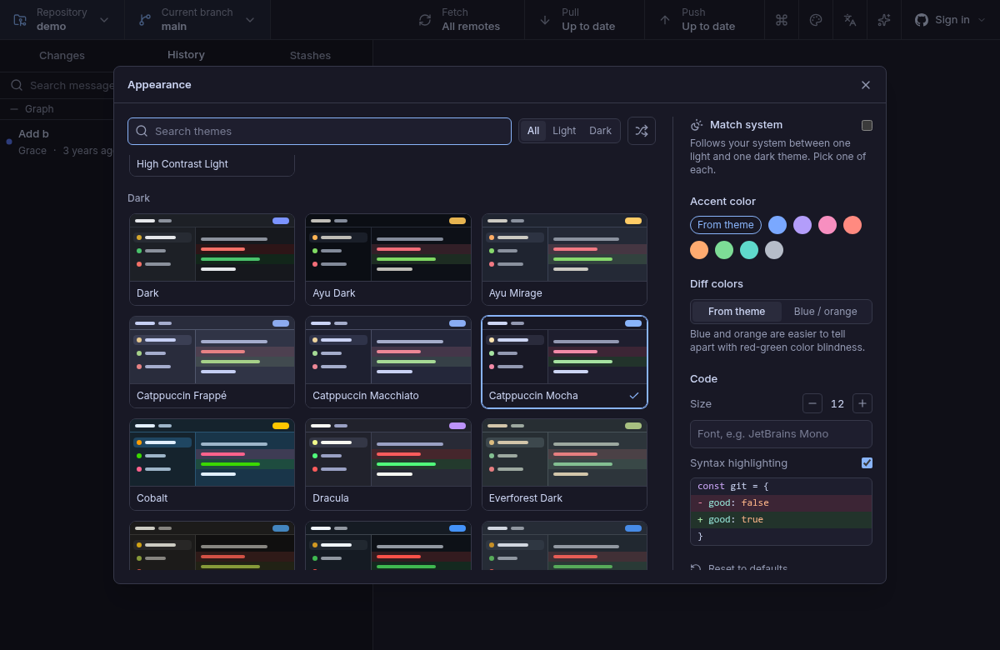

<p align="center">
  <picture>
    <source media="(prefers-color-scheme: dark)" srcset="logo/logo-dark.png">
    
  </picture>
</p>

<p align="center">
  <em>git gud at git.</em>
</p>

<p align="center">
  <a href="https://github.com/qiral/gitgud/actions/workflows/ci.yml"></a>
  <a href="https://github.com/qiral/gitgud/releases/latest"></a>
  <a href="LICENSE"></a>
</p>

A fast, lightweight, open-source Git GUI for Linux, Windows and macOS.

GitGud aims to be as approachable as GitHub Desktop while exposing more of Git's power: history, branches, stash, merges, conflict resolution and interactive rebase, without hiding what Git is doing.

> **Status:** early development. Expect rough edges. [Download the latest release](https://github.com/qiral/gitgud/releases/latest).


Pick a commit to browse its changed files one by one, right-click anything to copy its path, name or hash, and hide branch lines you don't care about with the "−" on their dots.

## Features

- Open any local repository (or pass it on the command line: `gitgud ~/code/project`)
- Clone from a URL or pick from your GitHub repositories, with live progress
- See changed files, stage and unstage per file or all at once, and discard changes
- Stage, unstage or discard individual lines and hunks right from the diff
- Right-click an untracked file to add it, all files with its extension, or its folder to `.gitignore`
- Merge branches and resolve conflicts block by block, or abort the merge
- Edit history: reorder commits by dragging, squash, fixup, reword or drop them
- Right-click a commit in History to cherry-pick or revert it, reset the current branch to it (soft, mixed or hard), or start a branch or tag there; tags can be pushed or deleted from the same menu
- Inline diff viewer with line numbers
- Commit (`Ctrl+Enter` in the message box), or amend the last commit to fix its message or add forgotten files
- Stash changes (optionally with untracked files), then apply, pop, preview or delete stashes
- Create, filter, switch, rename and delete branches (right-click a branch or use its "…" button; unmerged branches ask before they go)
- History with a commit graph across all branches, remote branches and tags; pick a commit or stash to browse its changed files one by one
- Search History by message, author or hash, and see the history of a single file (right-click it anywhere and pick "Show file history"), following renames
- Blame a file on disk or at any commit (right-click it and pick "Blame"): see who last changed each line, jump to that commit in History, or keep walking back through parents; optionally ignore whitespace and follow moved lines
- Compare two branches before you merge (`Ctrl+Shift+D`, or the branch menu) or two commits (`Ctrl`+click in History): the full diff, file by file, and the commits only one side has
- Diffs and blame are syntax highlighted in your theme's colors, for 45+ languages
- A repository with nothing to commit opens on History, one with changes on Changes
- Undo right after a commit, amend, merge, cherry-pick, revert, history edit, reset (even a hard one), branch or stash deletion or discarded files and lines; nothing done since then gets overwritten
- Browse the reflog of HEAD or a branch, and recover deleted stashes (`Ctrl+K`, "Reflog")
- Copy file names, paths, commit hashes and messages from right-click menus or the copy buttons, and show a file in its folder
- Fetch, pull and push, including publishing new branches; when your branch and its upstream have both moved on, pull asks whether to merge or rebase (or follows your `pull.rebase` setting)
- Manage remotes from the Repository menu: add, rename, edit, fetch or remove them, and add a fork's parent as `upstream` in one click. Merge any remote branch (`Ctrl+Shift+M`), set a branch's upstream from its menu, and pick the remote when publishing a branch or pushing a tag
- Sign in with GitHub (device flow, token kept in the OS keychain) to push over HTTPS
- Sign in to GitLab, Gitea, Forgejo or any other HTTPS host with a personal access token; each token is only sent to its own host
- Publish a local repository to GitHub in one step
- Create a pull request for the current branch from the toolbar (`Ctrl+R`): pick the base branch, start from the commits or let Copilot write the title and description, and save it as a draft. Branches pushed to a fork go to the parent repository. Once it's open, the toolbar links to it
- With a GitHub Copilot plan, once signed in with GitHub: generate commit and stash messages, review staged changes before committing, explain commits, stashes, changes and failed git commands, get a suggested merge for each conflict block, name a new branch from a description, draft release notes since a tag or between two commits, summarize what a branch would bring in before merging, and write one message for squashed commits. Each Copilot action can be turned off from the Copilot menu in the toolbar. GitGud runs the [Copilot CLI](https://github.com/github/copilot-cli) you already have, or downloads it once into its own folder, with its own settings so your Copilot MCP servers and plugins aren't loaded. It sends only the diff or conflict you asked about, so organization content exclusions don't apply to it
- Tells you when a new version is out and updates itself after you click (AppImage, Windows and macOS); an Update button stays in the toolbar until you do, and "Check for updates" sits in the account menu and on the start screen
- 40 themes with live previews (`Ctrl+,`), including Catppuccin, Gruvbox, Rosé Pine, Tokyo Night, GitHub, Everforest and high contrast ones; pick one, or a light and a dark one to follow your system. Change the accent color, use blue and orange diffs if red and green look alike to you, and set the font and size of code
- Speaks English, Türkçe, Azərbaycanca, Deutsch, Français, Italiano, Español, 日本語, 简体中文 and 한국어: it starts in your system's language and the 文A menu in the toolbar switches without a restart
- Drag panel edges to resize them (double-click to reset), collapse the history graph to a single line, or hide just the branch lines you don't care about
- Recent repositories on the start screen and in the Repository menu
- A command palette (`Ctrl+K`, `Cmd+K` on macOS) to search and run any action, and keyboard shortcuts for the common ones (press `F1` for the list)

### Keyboard shortcuts

Use `Cmd` instead of `Ctrl` on macOS.

| Shortcut | Action |
| --- | --- |
| `Ctrl+K` | Command palette |
| `Ctrl+P` / `Ctrl+Shift+P` | Push / Pull |
| `Ctrl+Shift+T` | Fetch |
| `Ctrl+R` | Create or view the branch's pull request |
| `Ctrl+B` | Switch branch |
| `Ctrl+Shift+N` | New branch |
| `Ctrl+Shift+M` | Merge a branch into the current one |
| `Ctrl+Shift+D` | Compare a branch with the current one |
| `Ctrl+Shift+S` | Stash changes |
| `Ctrl+1` / `Ctrl+2` / `Ctrl+3` | Changes / History / Stashes |
| `Ctrl+F` | Search history |
| `Ctrl+O` / `Ctrl+Shift+O` | Open / Clone a repository |
| `Ctrl+Enter` | Commit (in the message box) |
| `Ctrl+,` | Appearance |
| `F1` | List all shortcuts |

## Screenshots

**Stage exactly the lines you want.** Click line numbers in the diff (Shift+click for a range), or stage a whole hunk from its header.


**Resolve merge conflicts** block by block (ours, theirs or both), or take one side for the whole file.


**Edit history** without the terminal: drag commits into a new order, squash or drop them, or fix a message.


**Stash work in progress** and preview it before bringing it back.


**Pick a theme**, or let GitGud follow your system between a light and a dark one.



## Tech stack

- **[Tauri 2](https://tauri.app)** — native shell, small binaries
- **Rust** backend (`src-tauri/`) that drives the `git` CLI without a shell, so file names and commit messages can never be run as commands
- **React + TypeScript + Tailwind CSS** frontend (`src/`), built with Vite

## Development

Prerequisites:

- [Rust](https://www.rust-lang.org/tools/install) (stable, 1.94 or newer)
- [Node.js](https://nodejs.org) 20+
- `git` on your `PATH`
- Tauri's system dependencies for your OS: see [tauri.app/start/prerequisites](https://tauri.app/start/prerequisites/)

```bash
git clone https://github.com/Huseynteymurzade28/GitGud.git
cd GitGud
npm install
npm run tauri dev
```

To open a specific repository during development:

```bash
npm run tauri dev -- -- /path/to/repo
```

Other commands:

| Command                                           | What it does                       |
| ------------------------------------------------- | ---------------------------------- |
| `npm run tauri build`                             | Build a release bundle for your OS |
| `cargo test --manifest-path src-tauri/Cargo.toml` | Run the Rust tests                 |
| `npm run build`                                   | Type-check and build the frontend  |
| `npm test`                                        | Run the frontend unit tests        |
| `npm run test:e2e`                                | Drive the web UI in a real browser |
| `npm run format`                                  | Format the frontend with Prettier  |

The browser tests and the advisory visual baselines are explained in [docs/TESTING.md](docs/TESTING.md).

## Project layout

```
src/                  React frontend
  lib/git.ts          Typed wrappers for the Rust commands
  components/         UI components
src-tauri/
  src/git.rs          Git operations (runs the git CLI, parses its output)
  src/github.rs       GitHub sign-in, token storage and API calls
  src/hosts.rs        Token sign-in for other hosts, and the git credentials env
  src/lib.rs          Tauri commands exposed to the frontend
```

## Roadmap

Planned work lives in [GitHub issues](https://github.com/qiral/gitgud/issues). Issues labeled [good first issue](https://github.com/qiral/gitgud/issues?q=is%3Aissue+is%3Aopen+label%3A%22good+first+issue%22) are a nice place to start contributing.

## Releases

Push a tag such as `v0.2.0` and the Release workflow builds installers for Linux (AppImage, .deb, .rpm), Windows (.msi, .exe) and macOS (Intel and Apple Silicon .dmg), then attaches them to a draft GitHub release. Bump `version` in `src-tauri/tauri.conf.json` first. Builds are not code-signed yet, so Windows and macOS will warn on first launch.

Update bundles are signed with the updater key; the release workflow reads it from the `TAURI_SIGNING_PRIVATE_KEY` and `TAURI_SIGNING_PRIVATE_KEY_PASSWORD` secrets, and installed apps check each update against the public key in `tauri.conf.json`. For a local `npm run tauri build` without that key, add `-- --config '{"bundle":{"createUpdaterArtifacts":false}}'`.

## Contributing

Contributions are welcome. Open an issue to discuss larger changes before starting on them.

1. Fork the repository and create a branch: `git switch -c feature/my-feature`
2. Make your change; run `cargo test`, `npm test` and `npm run build`, plus `npm run test:e2e` if you touched the UI
3. Open a pull request

### Adding a language

The app reads all of its UI text from message files in `src/i18n/locales/`. English (`en.ts`) is the source of truth; every other file is optional and any key it lacks falls back to English, so a language can be added incrementally:

1. Copy `src/i18n/locales/en.ts` to `src/i18n/locales/<code>.ts` (e.g. `de.ts`, `zh-CN.ts`) and translate the values. Keep the keys, and keep `{placeholder}` names — they are filled in by `t(key, vars)` / `tp(key, count)`. Plural keys come in `.one` / `.other` pairs chosen by `Intl.PluralRules`.
2. Add the language's own name to `LANGUAGE_NAMES` in `src/i18n/index.tsx` (e.g. `de: 'Deutsch'`) so the picker in the toolbar shows it as “Deutsch”, not “de”. The picker only lists languages that have a file, and it appears once there are two to choose from; GitGud also picks the OS language by itself only when its file exists.
3. Use `const { t, tp } = useTranslation()` in components and replace hardcoded strings with `t('some.key')` / `tp('some.key', count)`. Code outside React, like `src/lib`, imports `t` and `tp` from `src/i18n` directly.
4. Run `npm test`. The tests in `src/i18n/i18n.test.tsx` fail if your file has keys English does not have, or if a translation drops or renames a `{placeholder}`; missing keys are fine (they fall back to English) until the translation is complete. If the tests don't see a file you just added, delete `node_modules/.vitest-cache` and run them again.

Dates and relative times go through `Intl` with the active locale in `src/lib/time.ts`, so no per-language date code is needed. Make sure layouts survive longer strings (German, French) and that the font stack in `src/index.css` covers your script (it already falls back to Noto Sans JP/SC/KR and friends for CJK).

## License

[MIT](LICENSE)
